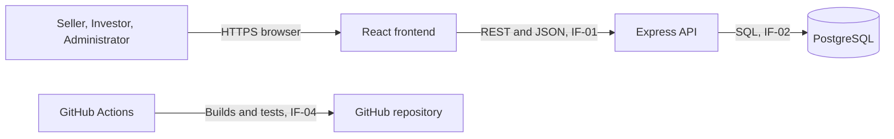
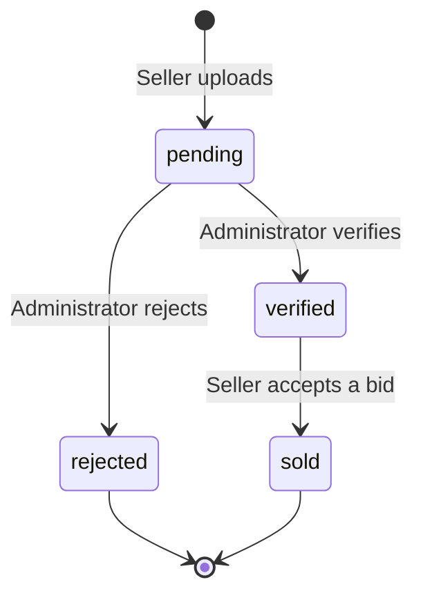
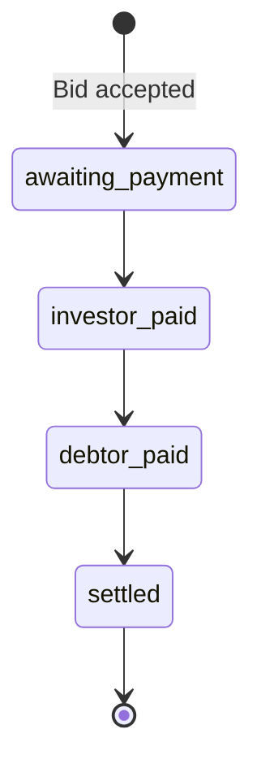
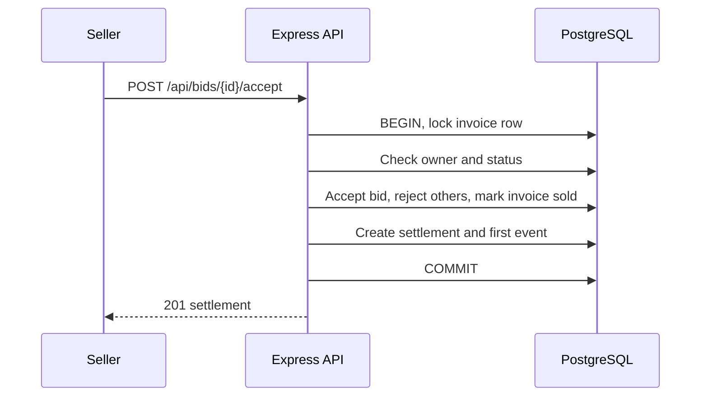

# Software Design Document

| Field | Value |
|---|---|
| CI ID | CI-DOC-03 |
| Version | 0.1 Draft, pending team review |
| Owner | Technical Leads |

## 1. Architecture

The system is a three-tier web application.

## 2. Components

| Component | Location | Responsibility |
|---|---|---|
| Authentication | `backend/src/routes/auth-routes.js` | Registration, login and token issue |
| Invoices | `backend/src/routes/invoice-routes.js` | Upload, marketplace, review, placing bids |
| Bids | `backend/src/routes/bid-routes.js` | Investor bid list and bid acceptance |
| Settlements | `backend/src/routes/settlement-routes.js` | Status updates and history |
| Reports | `backend/src/routes/report-routes.js` | Summary and history |
| Access control | `backend/src/middleware/auth-middleware.js` | Token verification and role checks |
| Validation | `backend/src/utils/validation.js` | Text, date and money validation |
| Migrations | `backend/src/migrate.js`, `database/migrations/` | Ordered schema changes |
| Web client | `frontend/src/` | Role-based dashboards |

## 3. Requirement allocation

| Requirement | Design element |
|---|---|
| FR-01 | Authentication; `users` table |
| FR-02, FR-03, FR-05 | Invoices; `invoices` table |
| FR-04 | Invoices and Bids; `bids` table |
| FR-06 | Settlements; `settlements`, `settlement_events` tables |
| FR-07 | Reports |
| NFR-01, NFR-02 | Authentication; Access control |
| NFR-03 | Validation; NUMERIC columns |

## 4. Invoice lifecycle

## 5. Settlement lifecycle

## 6. Bid acceptance sequence

Acceptance runs in one database transaction and locks the invoice row, so two bids cannot both be accepted.

## 7. Security design

- Passwords are hashed with bcrypt.
- JSON Web Tokens expire after 8 hours and are held only in browser memory.
- SQL statements use bound parameters.
- Secrets are supplied through environment variables.
