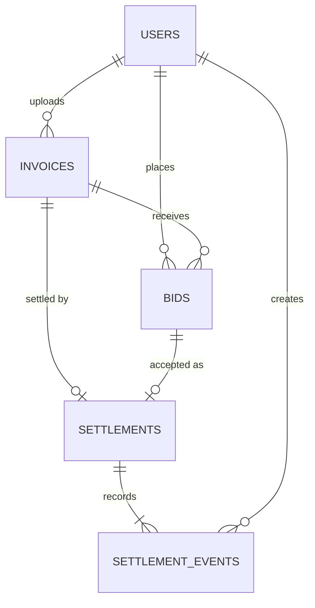

# Database Design and Data Dictionary

| Field | Value |
|---|---|
| CI ID | CI-DOC-10 |
| Version | 0.1 Draft, pending team review |
| Owner | Backend Lead |

## Entity relationship diagram

## Data dictionary

### users

| Column | Type | Rule |
|---|---|---|
| id | SERIAL | Primary key |
| full_name | VARCHAR(120) | Required |
| email | VARCHAR(160) | Required, unique |
| password_hash | VARCHAR(100) | bcrypt hash |
| role | VARCHAR(10) | seller, investor or admin |
| created_at | TIMESTAMPTZ | Defaults to now |

### invoices

| Column | Type | Rule |
|---|---|---|
| id | SERIAL | Primary key |
| seller_id | INTEGER | References users |
| invoice_number | VARCHAR(40) | Unique for each seller |
| debtor_name | VARCHAR(120) | Required |
| amount | NUMERIC(14,2) | Greater than 0 |
| asking_price | NUMERIC(14,2) | Greater than 0, not above amount |
| currency | CHAR(3) | Defaults to ETB |
| due_date | DATE | Required |
| status | VARCHAR(10) | pending, verified, rejected or sold |
| review_note | VARCHAR(255) | Optional |
| reviewed_by | INTEGER | References users |
| reviewed_at | TIMESTAMPTZ | Set on review |
| created_at | TIMESTAMPTZ | Defaults to now |

### bids

| Column | Type | Rule |
|---|---|---|
| id | SERIAL | Primary key |
| invoice_id | INTEGER | References invoices |
| investor_id | INTEGER | References users; one bid per investor per invoice |
| amount | NUMERIC(14,2) | Greater than 0 |
| status | VARCHAR(10) | open, accepted or rejected |
| created_at | TIMESTAMPTZ | Defaults to now |

### settlements

| Column | Type | Rule |
|---|---|---|
| id | SERIAL | Primary key |
| invoice_id | INTEGER | References invoices, unique |
| bid_id | INTEGER | References bids, unique |
| status | VARCHAR(20) | awaiting_payment, investor_paid, debtor_paid or settled |
| updated_at | TIMESTAMPTZ | Updated on change |

### settlement_events

| Column | Type | Rule |
|---|---|---|
| id | SERIAL | Primary key |
| settlement_id | INTEGER | References settlements |
| status | VARCHAR(20) | Status recorded |
| note | VARCHAR(255) | Optional |
| created_by | INTEGER | References users |
| created_at | TIMESTAMPTZ | Defaults to now |

## Scripts

Migrations are in `database/migrations/` and are applied in file-name order; `schema_migrations` records those applied. Synthetic demonstration data is in `database/seeds/`.
