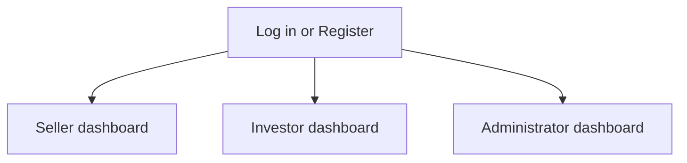
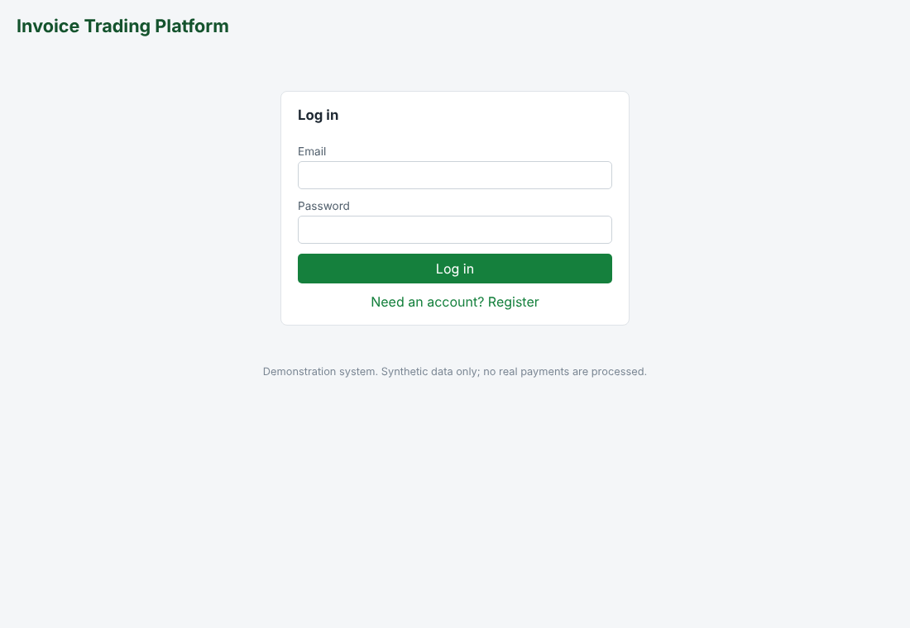
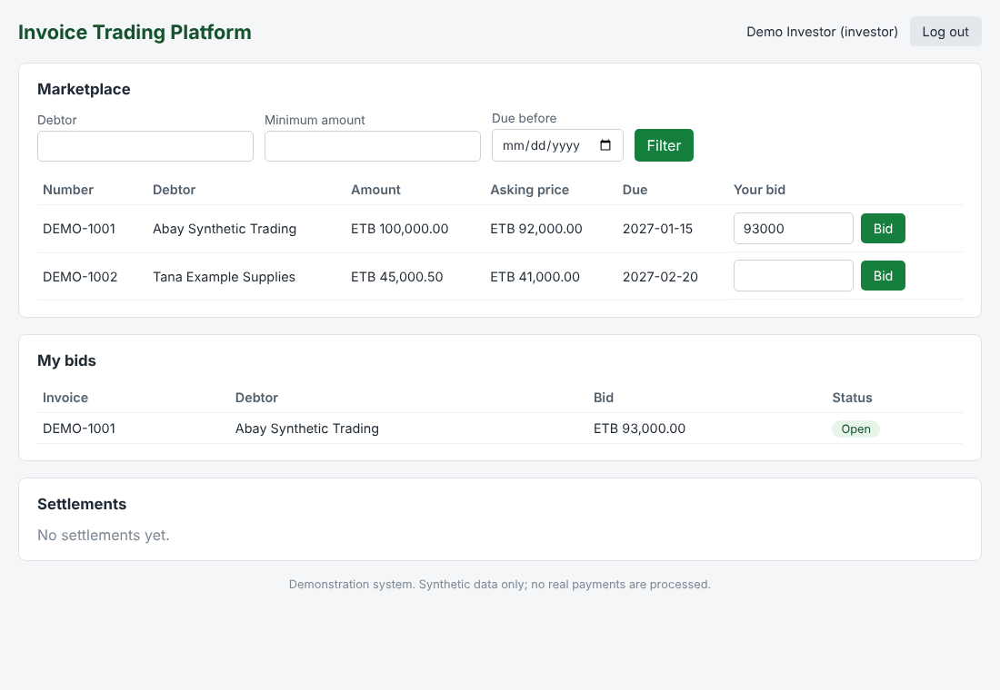
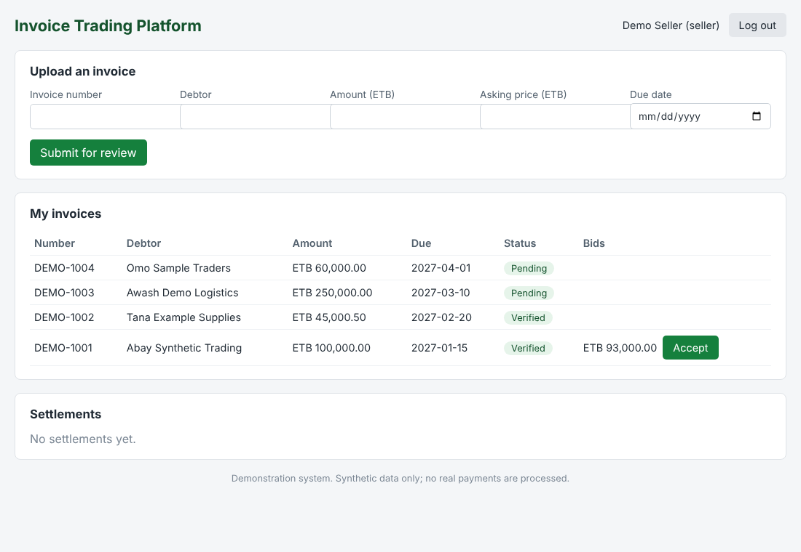
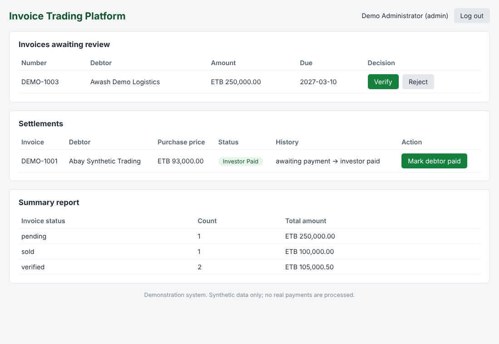

# User Interface Design

| Field | Value |
|---|---|
| CI ID | CI-DOC-09 |
| Version | 0.1 Draft, pending team review |
| Owner | Frontend Lead |

## Principles

One dashboard per role, plain labels, statuses shown as badges, and errors shown beside the action that caused them.

## Screen map

## Screens

These images are captured from the draft application running synthetic data.

### Log in

### Investor dashboard
Marketplace with filters, bid entry, bid list and settlements.

### Seller dashboard
Upload form, own invoices with bids, and settlements.

### Administrator dashboard
Review queue, settlement updates and summary report.

